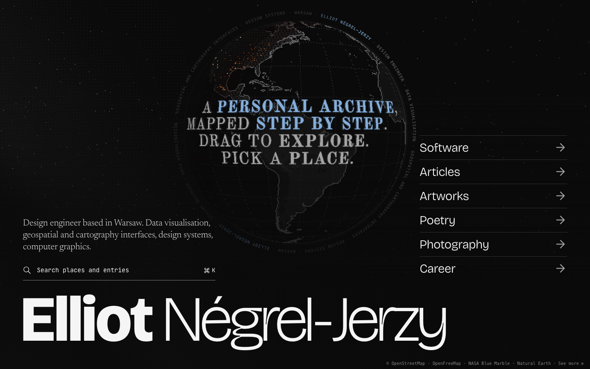
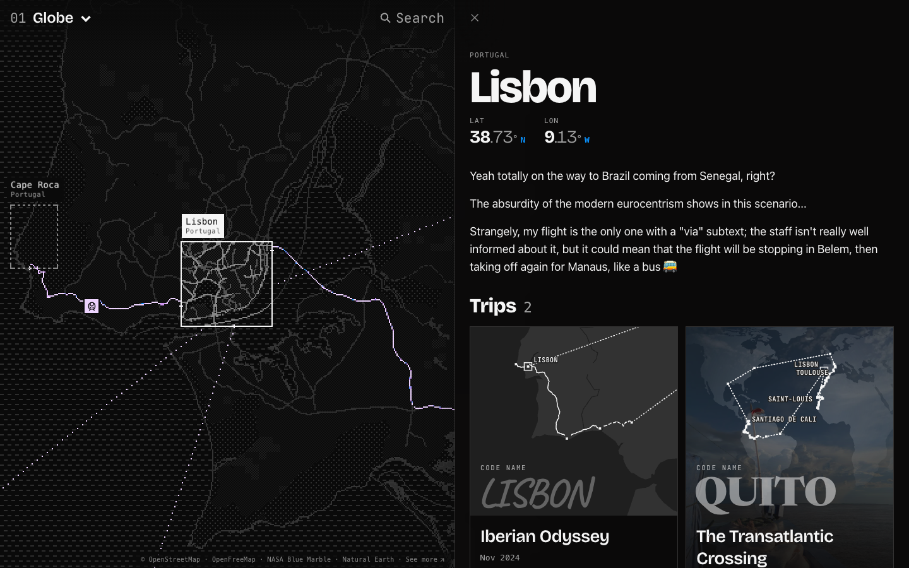
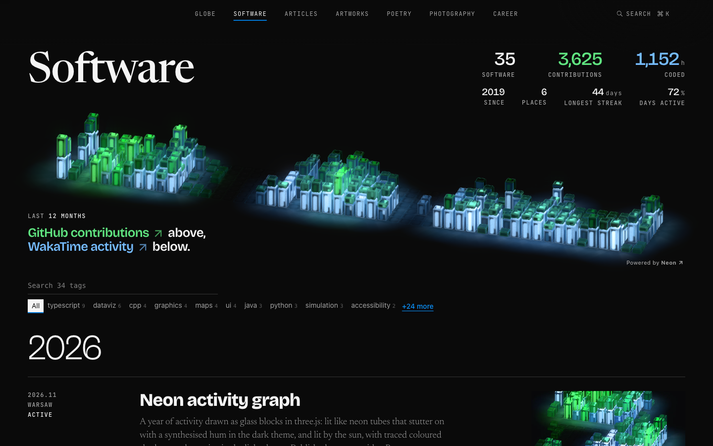
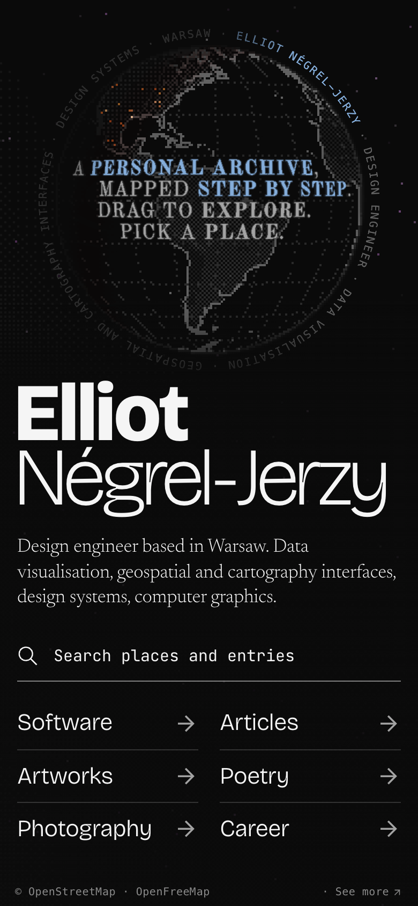

<div align="center">

# Catalyst

**A personal archive, mapped step by step.**
Spin a pixel-art globe, pick a place, and find the stories, software, articles, artworks and photographs attached to it.

[**Visit the site → bsodium.fr**](https://bsodium.fr) · [Read the docs](#documentation) · [Run it locally](#run-it-locally)



</div>

## What is this?

Catalyst is the personal website of [Elliot Négrel-Jerzy](https://bsodium.fr), a design engineer based in Warsaw. Instead of a list of pages, everything hangs off a **map**: trips, projects and writing are pinned to the places they belong to. You can wander the globe, zoom from the whole planet down to street level, or skip the map and browse by section.

This repository is the code behind the site. You don't need to read it to enjoy the site, but you're very welcome to.

## A quick tour

| | |
|---|---|
|  | **Places.** Zoom into any city and the globe turns into a pixel-art street map. Each place opens a panel with the trips that went through it and everything written, built or photographed there. |
|  | **Sections.** Software, Articles, Artworks, Poetry, Photography and a Career page. The software page draws a year of coding activity as glowing 3D blocks (the [neon-activity-graph](https://github.com/BSoDium/Neon-activity-graph) library). |
|  | **Everywhere.** Built phone-first: touch to spin the globe, search with <kbd>⌘</kbd> <kbd>K</kbd> (or the search line), light and dark themes, and an installable app feel. |

<details>
<summary>Light theme</summary>
<br>

</details>

## Under the hood

- **Web app** (`apps/web`): React 19 and React Router 7 (server-rendered), Tailwind 4, Motion. The globe is a custom [Three.js](https://threejs.org) renderer drawn through a pixel pass, with a [MapLibre](https://maplibre.org)-based street map at close range. [Why Three.js](docs/renderer-decision.md).
- **API** (`apps/api`): a small [Hono](https://hono.dev) service that serves the published content, read-only.
- **Content contract** (`packages/schemas`): a [zod](https://zod.dev) schema that defines exactly what may be published.
- **Plain, fast, private by default**: no cookies, no tracking beyond cookieless page views, and nothing reaches the public repo without passing an allowlist and a schema check.
- **Friendly to machines too**: Markdown versions of every page, an [`/llms.txt`](docs/llm-access.md), and an explicit policy for AI crawlers.

```
apps/
  web/          the website (React Router, Three.js globe)
  api/          read-only API over the published content
packages/
  schemas/      the published content contract
  published/    the published content itself (one JSON file) + loaders
  geodata/      coastline and border data for the globe
docs/           architecture, design system, decisions
```

## How content gets onto the map

Raw travel data and drafts live in a separate **private** repository. Only a reviewed, sanitised copy ever reaches this one.

```
Polarsteps trips ──▶ private repo (imports, hand-written drafts)
                          │  export: allowlist + schema check
                          ▼
              pull request here (published content)
                          │  merge = publication
                          ▼
                 website and API redeploy
```

If the importer breaks, the site simply keeps serving the last merged content.

## Run it locally

You need **Node 22+** and **pnpm 10**.

```bash
pnpm install
pnpm dev:demo       # website with made-up demo places: the quickest way to see everything
```

Then open <http://localhost:5173>.

Other useful commands:

```bash
pnpm dev            # website with the real published content (or your local preview)
pnpm dev:api        # API on http://localhost:3001
pnpm test           # unit tests
pnpm typecheck      # type-check every package
pnpm build          # production build
```

`pnpm dev` also listens on your local network, so you can open it on a phone. More on that, on previewing your own places, and the full list of commands and environment variables: [Development reference](docs/development.md).

## Documentation

**Start here**
- [Architecture overview](docs/architecture.md): layers, data flow, invariants, deployment
- [Development reference](docs/development.md): phone testing, local preview, all commands and environment variables
- [Owner's guide](docs/owner-guide.md): day-to-day recipes (add, edit, hide, publish, roll back)

**Design**
- [Design system](docs/design-system.md) and [design tokens](docs/design-tokens.md)
- [Landing hero](docs/landing.md): the typographic home page over the globe
- [Pixel line rules](docs/pixel-line-rules.md), [street map architecture](docs/street-architecture.md) and [the street zoom spike](docs/street-zoom-spike.md)
- Pages: [career](docs/career-page.md), [step page](docs/step-page.md), [activity picture](docs/activity-picture.md), [paths](docs/paths.md)
- [PWA system bars](docs/pwa-system-bars.md), [phone remount spec](docs/phone-remount-spec.md)

**Engineering**
- [Web architecture](docs/web-architecture.md): routing, data, focus management, globe lifecycle
- [Renderer decision](docs/renderer-decision.md): why standalone Three.js, with benchmarks
- [Performance](docs/performance.md): measurements and the budget check
- [API contract](docs/api-contract.md), [API cost and abuse](docs/api-cost-and-abuse.md)
- [Entry content model](docs/content-entry-model.md) and [media policy](docs/media-policy.md)
- [3D globe report](docs/globe-3d-report.md)
- [Language models and crawlers](docs/llm-access.md)
- [Self-hosting](docs/self-hosting.md)
- [Handoff](docs/handoff.md): state of the rebuild and what is left

The private content repository has its own docs (privacy model, import, editorial workflow, publication).

## Contributing

This is a personal project, so it isn't open to code contributions, but bug reports and ideas are welcome as issues. If you work on it with an AI agent, read [AGENTS.md](AGENTS.md) first.

## License

Source-available, not open source. You are welcome to read the code, learn from it, take inspiration, and reuse individual pieces (functions, shaders, components) in your own projects with attribution. You may not publish or deploy a copy of the site, and the Catalyst name, design and content are not licensed for reuse. See [LICENSE](LICENSE) for the exact terms.

`packages/geodata` is MIT. The three typefaces in `apps/web/public/fonts/` (Bricolage Grotesque, Newsreader, JetBrains Mono) are under the SIL Open Font License 1.1, with their licence texts beside the files.
