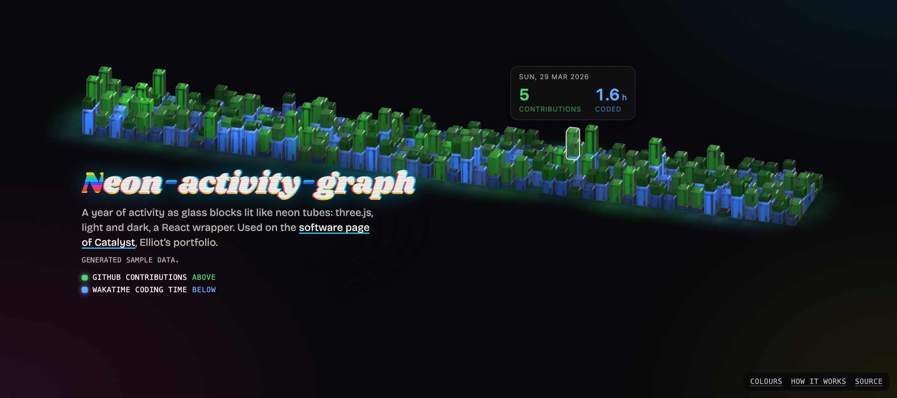
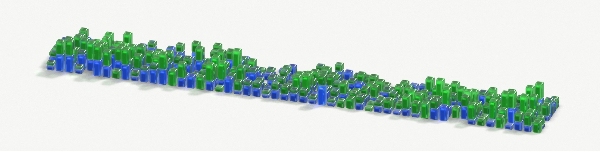

# Neon-activity-graph

A 3D activity graph in three.js: one glass block a day, two layers stacked in a column (say GitHub contributions on top of coding time), lit like a neon sign. In the dark theme the blocks' rods flicker on like gas tubes, with a synthesised hum; in the light theme the sun shines through the glass and casts coloured shadows and caustics. The camera never moves, so the picture is rendered progressively (soft shadows and anti-aliasing accumulated over a few dozen frames) and then the GPU goes idle.

It draws the graph only: no panel, no figures, no legend. Hover and keyboard events are handed to you as data (`onHover`) so the card is yours.

<p>
  
  
</p>

- Framework-agnostic core (`createActivityGraph`) and a React wrapper (`neon-activity-graph/react`)
- Generic data: two layers of `{ date, value }`; adapters for GitHub's contribution calendar and WakaTime's summaries
- Light and dark themes (following `prefers-color-scheme` by default), phone layout (4 strips), reduced motion, a `lite` mode
- No assets to bundle: the baked light of the dark theme is embedded (41 KB PNG, loaded only for the dark theme)
- `three` is a peer dependency, and is loaded on demand (`import("three")`), so the entry is small

## Install

```sh
npm install neon-activity-graph three
```

## Quick start

Vanilla:

```ts
import { createActivityGraph, fromGitHubCalendar } from "neon-activity-graph";

const graph = createActivityGraph(document.getElementById("graph")!, {
  data: {
    top: fromGitHubCalendar(calendar), // GitHub's contributionCalendar, or any { date, value }[] layer
    bottom: { label: "Coding", unit: "h", days: [{ date: "2026-11-19", value: 3.5 } /* ... */] },
  },
  onHover: (day) => { /* day: { date, top, bottom, x, y, outline } | null: show your card */ },
});

graph.update(newData);       // rebuilds the graph
graph.setTheme("dark");      // "light" | "dark" | "auto"
graph.destroy();             // frees the GPU resources and the listeners
```

Give the container a size: the picture fills it (about 4:1 for one strip; with `strips: 4`, about 4:5). It needs WebGL 2.

React:

```tsx
import { ActivityGraphView } from "neon-activity-graph/react";

<ActivityGraphView data={data} theme="auto" className="aspect-[4/1] w-full" onHover={setDay} />
```

`data` should be memoised (a new object rebuilds the graph); callbacks can be new closures at every render.

## Data

```ts
interface GraphData { top: GraphLayer; bottom: GraphLayer }
interface GraphLayer { label?: string; unit?: string; days: { date: string /* "2026-11-19", UTC */; value: number }[] }
```

The graph shows the last `weeks` weeks (53 by default) ending at the latest day of either layer; missing days are 0 (a flat tile). A block's height and colour follow `sqrt(value / max)` of its layer. Adapters (all pure, no network): `fromGitHubCalendar`, `fromWakaTimeSummaries`, `fromRecords(rows, date, value)`; `fakeLayer({ seed })` makes repeatable fake data for demos and tests.

## Options

| Option | Default | |
| --- | --- | --- |
| `data` | required | The two layers. |
| `weeks` | `53` | How many weeks are drawn. |
| `strips` | `1` | `1` is one long strip; `4` staggers four strips for a narrow, tall box (aspect about 0.8). |
| `theme` | `"auto"` | `"light"`, `"dark"` or `"auto"` (follows `prefers-color-scheme`). Change it with `setTheme`. |
| `colors` | green on top, blue below | `{ top?: { light?: [low, high], dark?: [low, high] }, bottom?: ... }`, colours as `#rrggbb` or `0xrrggbb`: the glass of a quiet day and of the busiest one. |
| `background` | nearest opaque ancestor background | A CSS colour, or `(theme) => css`. The ground takes it, so the picture has no seam with the page. Call `setTheme` again after it changed. |
| `rodColor` | `undefined` | `({ layer, index, date, t }) => [r, g, b] \| null`: the dark theme's rod colour (linear RGB, around 0..1; `t` is how busy the day was). Giving it turns on the "string of lights" look: clear glass, no grey veil, softer bloom; `null` keeps the default colour for that day. |
| `sound` | `true` | The synthesised hum and dings of the start-up. They play only once the browser lets the page make sound (after the visitor interacted with it) and only while the graph is on screen. |
| `reducedMotion` | `"auto"` | `"auto"` follows `prefers-reduced-motion`; when reduced there is no start-up and no flicker. |
| `lite` | `"auto"` | The light version: a third of the frames, lower resolution, simpler blocks. `"auto"` turns it on for coarse pointers and for machines with 4 cores or fewer or under 4 GB. |
| `grain` | `0.012` | Camera grain strength; `0` is off. |
| `templatesUrl` | embedded | URL of `caustic-templates.png` (see below) instead of the embedded data URI. |
| `label` | "Activity graph, ..." | The accessible name. The arrow keys walk the days (focus the graph by clicking it), Escape lets go. |
| `onHover` | | `(info \| null) => void`: `{ index, date, top, bottom, outline, x, y, behind }`. `outline` is the SVG `points` of the day's silhouette, `x, y` a point on its top in CSS pixels of the container. Clicking days that are behind one another cycles through them (`behind`). |
| `onReady` / `onLit` | | The first picture is on screen (fade your place-holder); the picture is lit (`false` while the start-up runs). |
| `startup` | | `({ inView }) => { start?, stop? } \| void`: called each time a start-up is prepared, to hook your own sound or greeting to it. |
| `debug` | | `{ metrics?, wireframe?, neonHold? }`: development helpers (`data-*` timings on the container, the glass as a cage, the picture held half on). |

A flat place-holder that shares the scene's camera (so the scene replaces it in place) can be drawn without loading three.js: `import { placeholderTiles } from "neon-activity-graph/layout"` gives an SVG `viewBox` and one path of all the squares.

## Performance

- Nothing moves, so the picture is drawn once, a frame at a time (96 jittered samples; 32 in `lite`), then the render loop stops. Hover only re-lights the blocks (a few frames, then stops again).
- The start-up and the idle flickers update the light of the blocks, not their geometry: a light update costs about 0.05 ms of CPU and a frame about 0.5 ms on an Apple M4; on an emulated Pixel 7 (CPU slowed 6x) 0.7-0.8 ms and 4-5 ms.
- The one-time build (geometry, ground light) stalls the main thread for a few hundred ms, up to 1.3 s on a slowed phone. Dark theme: the baked light is decoded once.
- The idle flickers run only while the graph is in view and the tab visible; `prefers-reduced-motion` skips the start-up altogether.
- three.js is imported on demand: until the graph is created nothing of it is loaded.

## Browser support

Anything with WebGL 2 and half-float render targets (current Chrome, Edge, Firefox, Safari 15+, iOS Safari). Without WebGL 2 the call fails (logged); check first and draw a fallback if you care (`document.createElement("canvas").getContext("webgl2")`).

## How the optics work

- **Light theme.** The sun's light through the glass is traced on the GPU (`ground-light.ts`, a vertex shader that splats rays onto the ground): refraction, Fresnel, total internal reflection, the glass's colour absorption, rounded edges. The ground's brightness is a signed difference to what it would have got with no glass, so shadows are coloured and soft and the caustics are the surplus. `glass-caustics.ts` is the readable CPU version of the same optics, with the tests.
- **Dark theme.** There is no sun; the light is each block's rod. What one block casts on the ground is *baked*: `assets/caustic-templates.png` holds path-traced templates (Mitsuba 3) of a glass block with a rod in it, for 3 heights x 4 heights above the ground, averaged over the square's symmetries. The graph lays the right template under every block, in the rod's colour. Tracing this live does not work: with the rays a page can afford the result is noise.
- **Start-up.** The blocks are split into 8 oval areas, each with its own stutter, then a warm-up; a block whose rod is off is dim and lit by its lit neighbours. The sound is Web Audio (a 100 Hz ballast hum and bell-like dings), no file. Afterwards, rarely and less and less, a batch of tubes flickers like a sign's.
- **Grain.** A soft, luminance-dependent noise added in the last pass, like a camera's.

### Regenerating the caustic templates

Only needed if the blocks' shape or the rod changes. See `scripts/caustic-templates/README.md` (Mitsuba 3, about 15 minutes), then `pnpm embed:templates` rewrites the embedded data URI (`pnpm build` does it too).

## Demo and playground

The [demo](https://bsodium.github.io/Neon-activity-graph/) draws the author's current activity (GitHub contributions over WakaTime coding time) and falls back to generated data when the activity file is not there. `demo/` is the page, `demo/scripts/fetch-activity.mjs` fetches public data without a token (a scheduled workflow writes `activity.json` to the `data` branch every 6 hours; set the repository variables `GITHUB_LOGIN` and `WAKATIME_USER` to draw somebody else).

```sh
pnpm demo  # the demo page
pnpm dev   # the playground: fake data and every option
```

## Releasing (maintainers)

Add the repository secret `NPM_TOKEN` (a token that can publish `neon-activity-graph`), bump `version` in `package.json`, then `git tag vX.Y.Z && git push origin vX.Y.Z`: the `release` workflow tests, builds and publishes with provenance.

## License

MIT
